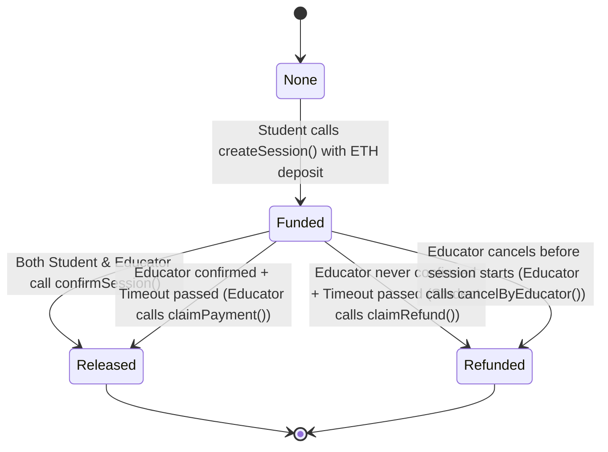

# On-Chain Tutoring Escrow for ArivuHub

A trustless, decentralized escrow system for online tutoring sessions on the **ArivuHub** learning platform.

Students deposit payment into a Solidity smart contract when booking a session. The funds are released to the educator only after both parties confirm the session was completed. Deterministic timeout and cancellation rules ensure neither side can hold funds hostage or stall indefinitely.

---

## 🎯 Problem Statement

In online tutoring marketplaces:
- **Students** fear paying in advance to a tutor who never shows up or cancels without refunding.
- **Educators** fear teaching a session and having the student refuse to pay or stall payment.
- **Traditional platforms** sit in the middle, hold the money, charge hefty commission fees, and require complete trust in a centralized arbiter.

### The ArivuHub Solution
Instead of a human middleman or centralized bank account, an immutable **smart contract** on Ethereum holds the funds in escrow. The rules are public code, execution is automated, and every booking path resolves to a fair payout or refund.

---

## 🏛️ Architecture & State Flow



### Money Flow Diagram

```text
Student --createSession(educator, sessionTime) + ETH--> [ TutoringEscrow Contract ]
   |
   +----------------------+-----------------------------+------------------------+
   |                      |                             |                        |
Both confirm           Educator never confirms       Educator confirmed,      Educator cancels
after session time     (no-show), timeout passed     student silent, timeout  before session starts
   |                      |                             |                        |
   v                      v                             v                        v
Educator PAID          Student REFUNDED              Educator PAID            Student REFUNDED
(Released)             (Refunded)                    (Released)               (Refunded)
```

---

## 📜 State Rules & Contract Matrix

| Situation | Who Can Act | Function Called | Preconditions | Outcome |
| :--- | :--- | :--- | :--- | :--- |
| **Session Booking** | Student | `createSession` | `msg.value > 0`, `educator != student`, `time > now` | Funds held in escrow; status = `Funded` |
| **Both Confirm (Happy Path)** | Student & Educator | `confirmSession` | `block.timestamp >= sessionTime` | On 2nd confirmation, 100% funds sent to educator; status = `Released` |
| **Educator No-Show** | Student | `claimRefund` | `now > sessionTime + timeout` and educator has NOT confirmed | 100% refund returned to student; status = `Refunded` |
| **Student Silent / Stalling** | Educator | `claimPayment` | `now > sessionTime + timeout` and educator HAS confirmed | Funds released to educator; status = `Released` |
| **Educator Cancellation** | Educator | `cancelByEducator` | `block.timestamp < sessionTime` | Session cancelled; student refunded in full; status = `Refunded` |
| **Unauthorized Caller** | Any stranger | Any action | Caller is neither student nor educator | Transaction reverts (`"Not a participant"` / `"Only student"` / `"Only educator"`) |

> **Note on Timeout**: The immutable timeout window (e.g. 300 seconds for demos, 48 hours for production) guarantees that funds are never locked forever.

---

## 💻 Tech Stack

- **Smart Contract**: Solidity `^0.8.20`, OpenZeppelin `ReentrancyGuard`
- **Development & Testing**: Hardhat, TypeScript, Ethers.js v6, Chai matchers
- **Network Helpers**: `@nomicfoundation/hardhat-network-helpers` (`time.increaseTo`)
- **Frontend**: Vite + React 18, TypeScript, Ethers.js v6, MetaMask integration
- **Target Network**: Ethereum Sepolia Testnet

---

## 📁 Repository Structure

```text
onchain-tutoring-escrow-for-arivuhub/
├── contracts/
│   └── TutoringEscrow.sol          # Main Solidity escrow contract
├── test/
│   └── TutoringEscrow.ts           # Comprehensive Hardhat & Chai test suite
├── scripts/
│   └── deploy.ts                   # Deployment script for Sepolia / Localhost
├── frontend/
│   ├── src/
│   │   ├── App.tsx                 # Two-tab React UI (Book & My Sessions)
│   │   ├── contractConfig.ts       # Contract address, ABI & Sepolia settings
│   │   ├── index.css               # Clean responsive styling
│   │   └── main.tsx                # App entrypoint
│   ├── index.html
│   ├── vite.config.ts
│   └── package.json
├── hardhat.config.ts               # Hardhat network & compiler configuration
├── .env.example                    # Template for Sepolia RPC & testnet key
├── .gitignore                      # Git ignore rules protecting .env and build files
├── package.json                    # Root scripts and devDependencies
└── README.md                       # Project documentation & guide
```

---

## 🚀 Getting Started

### 1. Prerequisites
- Node.js (LTS version)
- MetaMask browser extension installed
- A dedicated test-only wallet (never use a wallet with mainnet funds)
- Free Sepolia test ETH from any faucet (e.g., [Google Cloud Web3 Faucet](https://cloud.google.com/application/web3/faucet/ethereum/sepolia) or [Sepolia PoW Faucet](https://sepolia-faucet.pk910.de/))

### 2. Installation
Clone or navigate to the project directory and install dependencies:

```bash
# Install root Hardhat dependencies
pnpm install

# Install frontend dependencies
pnpm --filter frontend install
```

---

## 🧪 Running the Tests

The test suite thoroughly validates all 16 specification scenarios, including input validation, participant authorizations, time travel, balances, and zero-balance contract verification:

```bash
# Run the complete test suite
npx hardhat test
```

### Test Coverage Highlights:
- ✅ Zero-value deposits, invalid educator addresses, and past timestamps revert.
- ✅ Contract holds exact ETH deposit upon booking.
- ✅ Calling `confirmSession` before session time reverts.
- ✅ Third-party strangers cannot confirm or claim.
- ✅ Both confirming triggers automatic payment to educator and emits `Settled`.
- ✅ Claiming refund before timeout reverts; claiming refund after timeout without educator confirmation refunds student.
- ✅ Educator claiming payment after timeout with confirmation releases funds.
- ✅ Educator cancellation before session time refunds student; cancellation after start time reverts.
- ✅ Contract balance is strictly zero after every settlement.

---

## 🌐 Deploying to Sepolia Testnet

> **Security Reminder**: Never paste your private key into git, chat, or command prompts.

1. Create your local `.env` file from the template:
   ```bash
   cp .env.example .env
   ```

2. Open `.env` and fill in your details:
   ```ini
   SEPOLIA_RPC_URL=https://rpc.sepolia.org
   PRIVATE_KEY=your_testnet_private_key_here
   ESCROW_TIMEOUT=300
   ```

3. Run the deployment script:
   ```bash
   npx hardhat run scripts/deploy.ts --network sepolia
   ```

4. The script will output the deployed contract address. Copy that address:
   - Paste it into `frontend/src/contractConfig.ts`:
     ```typescript
     export const CONTRACT_ADDRESS = "0xYourDeployedAddressHere";
     ```
   - Update the **Deployed Contract** section below in this README.

---

## 🖥️ Running the Frontend

Start the Vite development server:

```bash
pnpm run frontend:dev
```

Open [http://localhost:3000](http://localhost:3000) in your browser:
1. Connect MetaMask and ensure your network is set to **Sepolia**.
2. **Book Session Tab**: Enter an educator's address, pick a future date and time, specify test ETH amount, and deposit.
3. **My Sessions Tab**: Inspect your active bookings, view live countdowns to session time and timeout expiry, and trigger allowed actions (Confirm, Claim Refund, Claim Payment, Cancel).

---

## 🛡️ Security Notes & Best Practices

1. **Checks-Effects-Interactions (CEI)**:
   The contract updates `s.status = newStatus` **before** executing `to.call{value: amt}("")`. This eliminates standard re-entrancy attack vectors.
2. **OpenZeppelin ReentrancyGuard**:
   Added `nonReentrant` modifier to external settlement entry points as defense-in-depth against unforeseen reentrancy loops.
3. **Strict Role-Based Access Control**:
   `confirmSession`, `claimRefund`, `claimPayment`, and `cancelByEducator` enforce strict caller validations (`msg.sender == s.student` or `msg.sender == s.educator`).
4. **Time Dependence**:
   Uses `block.timestamp`. Because timeout windows are measured in minutes or days, minor miner/validator timestamp manipulation (within ~15 seconds) cannot subvert the escrow rules.
5. **Secrets Hygiene**:
   `.env` is listed in `.gitignore`. Keys and sensitive endpoints are never committed to version control.

---

## ⚠️ Limitations

- **No Third-Party Dispute Arbiter**: If student and educator disagree on whether a session was delivered satisfactorily, the contract resolves the outcome purely based on confirmation flags and timeouts.
- **Test ETH Volatility & Currency**: Uses native ETH on Sepolia testnet. In production, pricing in volatile ETH exposes both parties to exchange rate fluctuations.
- **Recipient ETH Acceptance**: If an educator or student address is a contract that does not implement `receive()` or `fallback()`, the `.call{value: amt}("")` will revert.
- **Student Cannot Unilaterally Cancel**: To protect educator scheduling, only the educator can cancel a session before it begins.

---

## 🔮 Future Work & ArivuHub Roadmap

1. **Arbiter or DAO Multi-Sig Dispute Resolution**: Introduce an optional trusted resolver (e.g. ArivuHub platform mediator or community DAO) to split escrow funds (50/50 or percentage) when both parties dispute.
2. **ERC-20 Stablecoin Support**: Enable payment via USDC / USDT so session fees remain fixed regardless of crypto market volatility.
3. **Student Cancellation Policy**: Allow students to cancel with full refund up to 24 hours before the session, or partial refund within 24 hours.
4. **Pull-Payment Pattern**: Adopt OpenZeppelin `PullPayment` (withdrawal pattern) to prevent malicious recipient contracts from blocking payouts.
5. **On-Chain Reputation & Verified Credentials**: Link completed session escrows to the ArivuHub on-chain educator credential registry to generate verifiable teaching ratings.

---

## 📝 Deployed Contract & Proof of Work (Placeholders)

*Record your testnet deployment values here after running `deploy:sepolia`:*

- **Network**: Ethereum Sepolia Testnet
- **Contract Address**: `0x........................................`
- **Timeout Parameter**: `300` seconds (5 minutes)
- **Deployment Transaction**: `https://sepolia.etherscan.io/tx/0x...`
- **Happy-Path Session Transaction (Deposit)**: `https://sepolia.etherscan.io/tx/0x...`
- **Happy-Path Settlement Transaction (Released)**: `https://sepolia.etherscan.io/tx/0x...`
- **Refund Path Settlement Transaction (Refunded)**: `https://sepolia.etherscan.io/tx/0x...`

---

## 📄 License

This project is licensed under the MIT License.

